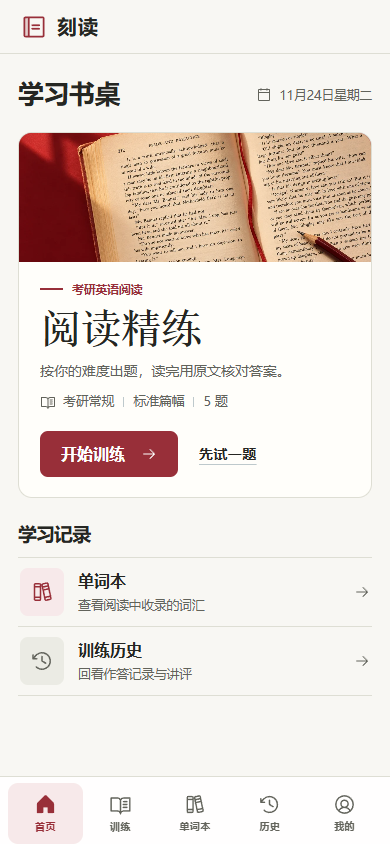
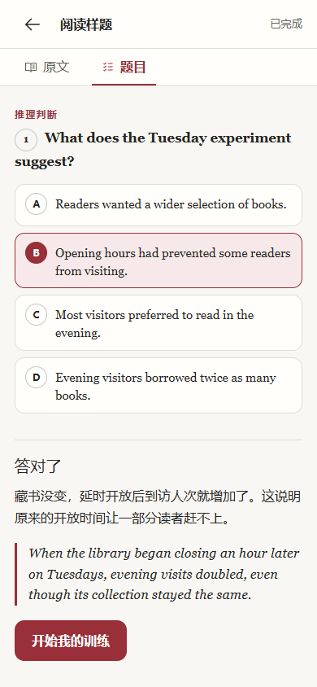

# 刻读 · Kedu Reading

刻读是一款个人考研英语阅读练习应用，支持 Android 手机、平板和浏览器。打开首页的 **先试一题**，就能读一篇关于图书馆延时开放的短文，做一道推理题，再回到原文看哪句话支持答案。这道内置样题可以离线完成，无需模型密钥。

<p>
  
  
</p>

Android 安装包可从 [GitHub Releases](https://github.com/wjianglong001/kedu-reading/releases/latest) 下载。

## 用自己的题目练习

1. 点 **开始训练**，选难度和主题。在 **更多设置** 里可以选篇幅、题数、题型重点、生词和长难句密度，并开启计时。
2. 首次填写并验证自己的 MiniMax API Key 后，点「生成阅读训练」，审校通过会自动进入作答页。出题时按原句编号选取证据、例句和长难句。独立审校核对答案和解析，有问题会自动修订并复审。第三轮仍有明确的局部错误时，应用会自动处理第四轮。达到上限仍需修订的草稿会保存在本机。
3. 手机上可以切换原文和题目，宽屏上可并排阅读。阅读时可以查词、看译文、保存标注。
4. 交卷后，应用按已保存的标准答案在本地计分，再请求 AI 讲评。历史记录和单词本保存在当前设备。

## 在浏览器里运行

开发环境使用 Node.js 24 和 npm。克隆项目后，在项目根目录执行：

```sh
npm ci
npm run dev -- --host 127.0.0.1
```

打开终端显示的本机地址。只看界面和试做内置样题时，无需准备环境变量。

```sh
npm test           # 离线单元测试
npm run build      # 类型检查和生产构建，产物位于 dist/
npm run preview    # 在浏览器中查看生产构建
```

## 构建 Android APK

准备 JDK 21、Android SDK Platform 36，并通过 Android Studio 或 `ANDROID_HOME` 指定本机 SDK。应用最低支持 Android 7.0（API 24）。

```sh
npm ci
npm run android:sync
cd android
./gradlew assembleDebug
```

Windows PowerShell 中，最后一条命令使用 `.\gradlew.bat assembleDebug`。生成的调试包位于 `android/app/build/outputs/apk/debug/app-debug.apk`。

## 数据与模型调用

- 生成、审校、在线查词和 AI 讲评由客户端直连 MiniMax，按个人账户计费。自定义练习为模拟题。独立审校和本地检查仍可能漏掉内容错误。
- 生成与审校会发送训练配置和练习内容，在线查词会发送所选文本和上下文，讲评会发送作答信息。学习数据库使用 Dexie / IndexedDB 保存在设备上，清除应用数据会清除学习记录。
- Android 版通过系统安全存储保存 Key，浏览器版使用当前站点的 localStorage。建议在自己的设备上输入 Key，可在 **我的** 页面移除。浏览器直连模型还取决于服务商的跨域支持。

## 源码入口

| 位置 | 职责 |
| --- | --- |
| `src/App.tsx`、`src/ReaderWorkspace.tsx` | 页面导航、原文与答题布局、交卷与讲评 |
| `src/agentOrchestrator.ts` | 分阶段生成、校验、修订与保存 |
| `src/minimax.ts`、`src/prompts.ts`、`src/schemas.ts` | 模型请求、提示词与结构校验 |
| `src/readingLookup.ts`、`src/db.ts` | 上下文查词、标注及学习数据 |
| `android/` | Capacitor Android 工程与 Gradle Wrapper |

## 许可证

本项目使用 [MIT 许可证](LICENSE)。第三方依赖及 Gradle Wrapper 遵循各自的许可证。
